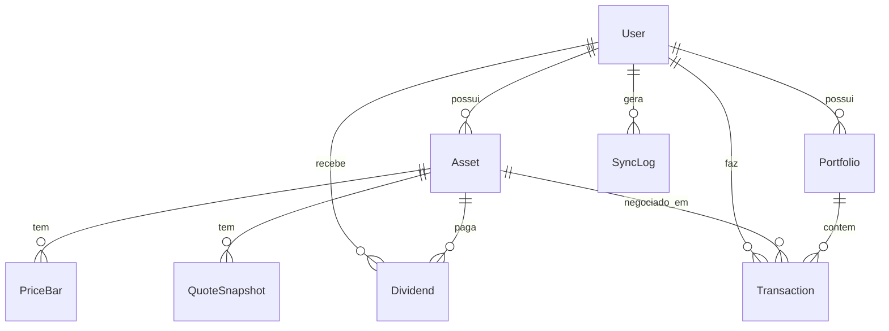

# Modelo de dados (Prisma / PostgreSQL)

Fonte da verdade: `backend/prisma/schema.prisma`.

## Enums

`AssetClass` (STOCK, FII, FUND, TREASURY, OTHER) · `DataSource` (MANUAL, BRAPI) · `TxType` (BUY, SELL) ·
`DividendKind` (DIVIDEND, JCP, RENDIMENTO, AMORTIZACAO, OTHER)

## Entidades

| Modelo          | Finalidade                            | Observações                                                                     |
| --------------- | ------------------------------------- | ------------------------------------------------------------------------------- |
| `User`          | Usuário do sistema                    | `email` único; `passwordHash` (bcrypt); todos os dados pertencem a um usuário  |
| `Asset`         | Cadastro do ativo                     | `symbol` único; `source` define se entra no sync da brapi; `userId` = dono      |
| `PriceBar`      | Série diária OHLCV                    | Único por (`assetId`,`date`,`source`); `date` é `@db.Date`; `volume` é `BigInt` |
| `QuoteSnapshot` | Cotação pontual                       | Histórico de snapshots; `quotedAt` vem da brapi                                 |
| `Dividend`      | Proventos                             | Manual ou sync (único por ativo+pagamento+tipo+valor; `source` indica origem)   |
| `MacroPoint`    | Observações macro (selic, cdi, ipca…) | Único por (`slug`,`date`); `unit` guia a acumulação (dia/mês/ano)               |
| `FiiIndicator`  | Série mensal de indicadores de FIIs   | Único por (`assetId`,`referenceDate`); P/VP, DY, patrimônio, cotistas           |
| `FundIndicator` | Snapshot do fundo (1 por ativo)       | Preço, cota, ágio/deságio, DY mensal; atualizado a cada sync                    |
| `Portfolio`     | Carteira                              | Agrupa transações; `userId` = dono                                              |
| `Transaction`   | Compra/venda                          | Quantidade, preço unitário, taxas, data; `userId` = dono                        |
| `SyncLog`       | Auditoria de sincronizações           | operação, símbolos, status, HTTP, mensagem; `userId` opcional                   |

## Regras e cuidados

- `User` → todos: `onDelete: Cascade`.
- `Asset` → `PriceBar`/`QuoteSnapshot`/`Dividend`: `onDelete: Cascade`. `Asset` → `Transaction`: **sem cascade** (RESTRICT intencional; excluir ativo com transações retorna 409).
- Todos os modelos de dados (exceto `MacroPoint` e `SyncLog` que podem ser globais) têm `userId` com índice, garantindo isolamento por usuário.
- Valores monetários: `Decimal(18,6)`; quantidades: `Decimal(18,8)`; market cap: `Decimal(24,2)`.
- Migrations versionadas em `backend/prisma/migrations/` (primeira: `20261014202306_init`; `add-user-and-ownership` adiciona `User` e `userId`).
- Fundos (CVM) e Tesouro Direto são `Asset` com `assetClass` apropriada e preços inseridos manualmente (NAV/PU como `close`). Sem tabela de indicadores específicos (P/VP, DY, vacância etc.).
